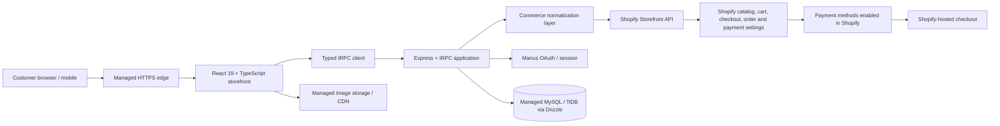

# Indulge Essentials — System Architecture

**Status:** Phase 1 architecture baseline, 27 September 2026  
**Business:** Single-vendor Kenyan retail, English / KES, Nairobi-first delivery  
**Marketplace mode:** Designed as a future extension; disabled by default.

## 1. Architecture overview

The storefront is a custom React application; Shopify is the source of truth for catalog, variants, prices, product availability, cart and hosted checkout. The injected server module (`server/_core/shopify.ts`) owns Storefront API calls and `shopifyNormalize.ts` isolates vendor-specific response shapes. The browser consumes only typed `commerce.*` tRPC procedures and shared normalized types.

The project scaffold provides Express, tRPC, Drizzle, MySQL/TiDB, and Manus OAuth. This is the managed runtime actually provisioned in this session. PostgreSQL, Next.js, Prisma, and Redis were recommendations in the supplied brief, not the generated platform; adopting them would require a deliberate infrastructure migration rather than silently pretending they are present.

## 2. Critical commerce flows

### Browse and cart
1. React requests products/collections through `commerce.products.*` and `commerce.collections.*`.
2. The server calls the Shopify Storefront API and normalizes results.
3. Add/update/remove operations run server-side through `commerce.cart.*`; Shopify validates merchandise and quantities.
4. Cart identity is stored in browser local storage by the provided cart context. No payment credentials or card data are stored in the app.

### Checkout, payment, and order
1. The customer reviews the Shopify cart and is redirected to its returned hosted checkout URL.
2. Payment methods and payment verification are configured and enforced by Shopify and its enabled payment provider.
3. The application must never infer payment success from a browser redirect. Order/payment status must be read from the commerce source of truth.
4. M-Pesa is a business requirement, not an active integration in this milestone. Before launch, configure a Shopify-supported Kenyan payment method or implement and security-review a server-side Safaricom Daraja adapter with verified, idempotent callbacks. Do not collect M-Pesa PINs or card numbers in the storefront.

### Identity and data ownership
- Manus OAuth/session supports application identity. Guest browsing and Shopify checkout remain available independently.
- Shopify owns products, variants, price, stock, cart, checkout, and order/payment records in this integration.
- The application database currently owns the scaffold user identity table. Customer profile extensions, wishlists, support, analytics, and audit records belong in application-owned tables only when those features are implemented.
- Do not duplicate Shopify-owned commerce records without an explicit synchronization and reconciliation design.

## 3. Security boundaries

- Shopify Storefront credentials are server-side environment values only; never bundle them into Vite variables or return them through tRPC.
- All Shopify requests go through the injected server scaffold. Do not call Shopify directly from React or write a second GraphQL client.
- Checkout is hosted by Shopify; the app does not handle card data or mark an order paid.
- Use schema validation, server-side authorization, secure session cookies, rate limits for public mutation endpoints, and minimal personal-data collection.
- Administrative and seller features are not enabled just because a route is hidden; every future mutation requires backend role checks.

## 4. Roles and permission matrix

| Capability | Guest | Customer | Support agent | Store manager | Administrator | Future seller |
|---|---:|---:|---:|---:|---:|---:|
| Browse/search catalog | Yes | Yes | Yes | Yes | Yes | Yes |
| Manage own profile/addresses | No | Yes | No | No | Support as authorized | No |
| Manage own cart / checkout | Yes | Yes | No | No | No | No |
| View own orders / returns | No | Yes | Authorized support view | Yes | Yes | Own orders only, future |
| Review a purchased item | No | Yes, purchase-gated | No | Moderate | Moderate | No |
| Manage products / stock | No | No | No | Yes | Yes | Own products only after marketplace enablement |
| Manage orders/promotions | No | No | No | Yes | Yes | Own orders only, future |
| Respond to support tickets | No | Own tickets | Yes | Authorized | Yes | No |
| Manage users, roles, security, settings | No | No | No | No | Yes | No |
| Seller verification, commissions, payouts | No | No | No | No | Admin-controlled future | No; disabled until configured |

The generated scaffold currently has the built-in `user` / `admin` distinction. The richer roles above are target policy; do not present them as implemented until database roles and server authorization checks are added.

## 5. API architecture

The live app uses tRPC at `/api/trpc` rather than hand-written REST. Current integration procedures are documented in [API.md](./API.md). Future REST adapters may be added for approved external clients, but must delegate to the same domain services and validation rules.

## 6. Sitemap / page structure

### Customer storefront
- `/` — campaign-led homepage, category shortcuts, featured products, trust and delivery benefits.
- `/shop` — searchable and filterable catalog.
- `/collections/:handle` — collection/category listing.
- `/products/:handle` — product detail, gallery, availability, quantity, wishlist and cart actions.
- Cart drawer / `/cart` — cart lines, quantity changes, totals, remove action.
- Shopify hosted checkout — external secure checkout URL returned by the cart.
- `/account` — sign-in and future profile/orders/addresses.
- `/wishlist` — saved products (persist locally for guest preview; account synchronization is a later feature).
- `/pages/shipping`, `/pages/returns`, `/pages/contact`, `/pages/privacy`, `/pages/terms` — clear policy/support destinations.

### Administration (later milestone)
- `/admin` dashboard; `/admin/products`; `/admin/inventory`; `/admin/orders`; `/admin/customers`; `/admin/promotions`; `/admin/reviews`; `/admin/returns`; `/admin/support`; `/admin/reports`; `/admin/settings`.
- Admin routes must not be exposed as active capabilities until protected server procedures and role grants exist.

## 7. Development roadmap

| Milestone | Scope | Exit criteria |
|---|---|---|
| 1. Architecture | Decisions, role matrix, ERD, API map, sitemap, design system | Documents reviewed; platform-specific deviations recorded |
| 2. Storefront foundation | Brand shell, responsive home/shop/product, search, wishlist, cart drawer | No dead primary actions; loading/empty/error states; keyboard and mobile pass |
| 3. Shopify commerce | Product/collection query, cart mutations, hosted checkout | Product probe and cart smoke checks pass on the connected store |
| 4. Customer lifecycle | Accounts, addresses, order history/tracking, support and returns | Server authorization and test coverage for account-owned data |
| 5. Operations/admin | Product, inventory, order, promotion, review and support management | Role-specific server authorization, audit trails, import/export |
| 6. Kenya launch readiness | Shipping zones, tax rules, M-Pesa/provider configuration, notifications | Provider credentials, callback verification, reconciliation, live test sign-off |
| 7. Commercial hardening | SEO, analytics/consent, monitoring, accessibility, performance, backups | Security, accessibility, failure-mode, and launch checklists pass |
| 8. Optional marketplace | Seller verification, dashboards, commissions and payouts | Explicit admin enablement, seller isolation, payout controls and legal review |

## 8. Indulge Essentials visual system

- **Positioning:** curated everyday essentials with a warm, considered premium feel—local and approachable, never discount-marketplace clutter.
- **Palette:** cream `#F7F3EC`, ink `#292923`, muted sage `#75816C`, clay `#B96F4E`, soft stone `#E7E1D7`, white `#FFFEFB`.
- **Typography:** high-contrast editorial serif for large campaign/product headlines; clean sans-serif for navigation, forms, prices, and dense content.
- **Layout:** warm ivory canvas, asymmetric editorial hero, generous whitespace, compact utility bar, clear product grid, restrained borders/shadows, strong mobile bottom/cart actions.
- **Components:** accessible header/search, category tiles, product card, price/rating/stock indicator, filter drawer, product gallery, cart drawer, toast/alert, shipping benefit strip, footer.
- **Motion:** short 150–220 ms ease-out transitions, limited to opacity/transform, disabled or reduced under `prefers-reduced-motion`.

## 9. Decisions and assumptions

1. Start single-vendor; seller/marketplace functionality stays off.
2. Kenya / KES / English; Nairobi-led delivery messaging is provisional until service zones and rates are supplied.
3. Shopify is the commerce system of record because the managed integration scaffold is available; the new development store still needs the owner's product catalog and launch payment configuration.
4. One clearly identified development preview product is allowed because no catalog was supplied; it is not a representation of verified stock or a live commercial offer.
5. The initial site milestone is a storefront foundation, not a claim that every feature in the 2,473-line brief or real payments, fulfillment, refunds, or production operations are already implemented.
