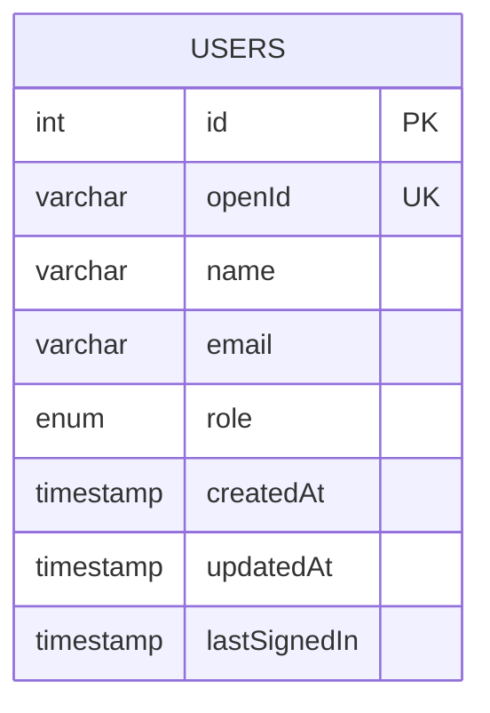
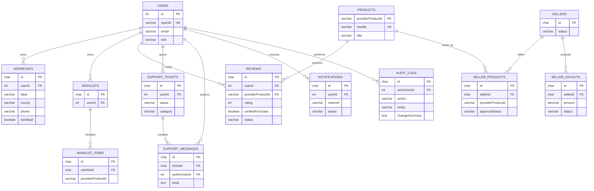

# Database and Data Ownership

## Current implementation

The project uses the managed MySQL/TiDB database through Drizzle ORM, not PostgreSQL/Prisma. The scaffold currently has the `users` table for Manus OAuth identity (`id`, `openId`, `name`, `email`, `loginMethod`, `role`, timestamps, last sign-in). No production order or payment tables have been created.

The Shopify storefront integration is the source of truth for product, variant, price, stock availability, cart, checkout and Shopify order/payment records. The app must not create duplicate tables for those entities unless a later synchronization design defines stable external IDs, webhook verification, idempotency, reconciliation and retention.

## Current identity ERD

## Target logical commerce ERD

This is a roadmap model, not a claim that all these tables exist. Product, variant, inventory, cart, order and payment data remain Shopify-owned for the current architecture. Application-owned records are linked by provider IDs and contain only fields needed by app features.

## Design rules for future tables

- Prefer opaque UUID/ULID identifiers for app-owned records and provider GIDs/IDs for external entities.
- Add foreign keys, unique constraints, soft-delete only where recovery/audit requirements justify it, and indexes for owner/status/time/provider ID.
- Store timestamps in UTC. Store money as integer minor units plus ISO currency code or fixed-precision decimal with explicit currency; never use floating point.
- Persist object-storage keys and safe metadata, never raw image/document bytes in the relational database.
- Make webhook event IDs unique and process callbacks transactionally/idempotently before changing payment/order projections.
- Store only necessary PII, protect access by user ownership and server authorization, and define retention/export/deletion policies before launch.
- Marketplace entities stay inactive until admin-controlled feature enablement and seller-isolation tests are complete.

## Migration workflow

For schema changes: edit `drizzle/schema.ts`, generate migration SQL with the project Drizzle command, review the generated SQL, apply through the managed database workflow, and verify migration state. Do not manually claim a schema change has been applied merely because TypeScript types compile.
